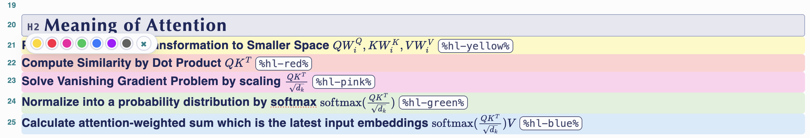
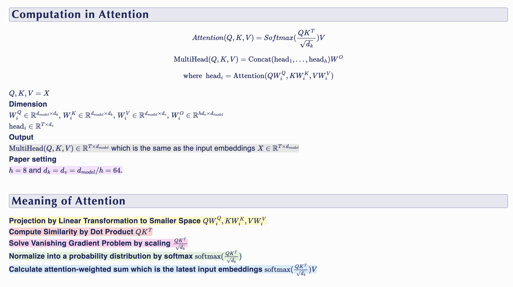

# Highlight By Line

Highlight lines in Obsidian using simple Markdown markers such as `%hl-yellow%`. View highlights in Reading view, Live Preview, and Source mode, with customizable colors for light and dark themes.

## Features

- **Highlights while writing:** Marked lines have a colored background. The `%hl-color%` marker stays visible and editable as a distinct pill.
- **Reading view:** Markers are hidden and their text is highlighted, including individual items in nested lists.
- **Line-number palette:** Click a line number to choose a color or clear its highlight. Palette changes support undo.
- **Custom colors:** Set separate light and dark theme backgrounds for all seven colors. Palette dots keep their original vivid colors so choices remain easy to identify.
- **Plain Markdown:** Markers are stored directly in your note.

## Installation

### Manual installation

You need Obsidian and these three plugin files: `manifest.json`, `main.js`, and `styles.css`.

1. Download the three files from a [GitHub release](https://github.com/tracywong117/obsidian-plugin-highlight-by-line/releases).
2. Inside your vault, create this folder:

   ```text
   .obsidian/plugins/highlight-by-line/
   ```

3. Copy the files into it so the folder contains:

   ```text
   highlight-by-line/
   ├── manifest.json
   ├── main.js
   └── styles.css
   ```

4. Reload Obsidian.
5. Open **Settings → Community plugins**, enable community plugins if needed, and enable **Highlight By Line**.

Node.js, npm, and the source files are only needed for development. They are not required to use a compiled release. If release files are unavailable, build the plugin using the development instructions below.

## Usage

### Add a marker

Place a supported marker at the end of a line:

```markdown
This line has no highlight.
This is important! %hl-yellow%

### Character notes %hl-purple%

- Background: Grew up in a small town. %hl-blue%
- Appearance: Silver hair and gray eyes. %hl-pink%
```

In **Live Preview and Source mode**, the line is highlighted and the marker remains editable. In **Reading view**, the marker is hidden and the text is highlighted.

### Use the line-number palette

1. Enable **Settings → Editor → Show line numbers**.
2. In writing view, click the number beside the line you want to highlight.
3. Choose a color, or click **×** to remove the highlight.

You can also clear a highlight by deleting its marker directly.

## Supported colors

| Color | Marker |
| --- | --- |
| Yellow | `%hl-yellow%` |
| Red | `%hl-red%` |
| Pink | `%hl-pink%` |
| Green | `%hl-green%` |
| Blue | `%hl-blue%` |
| Purple | `%hl-purple%` |
| Gray | `%hl-gray%` |

## Customize colors

Open **Settings → Highlight By Line**.

- Choose a background using the color picker or enter a six-digit hex code, such as `#fffacd`.
- Configure light and dark theme colors separately.
- Use the reset button beside a color to restore its default.

Changes apply immediately to writing and Reading views and are saved automatically. Customization changes the background associated with each marker; marker names stay the same. The line-number palette always uses the default vivid colors.

## Screenshots

### Line-number palette



### Reading view



## Development

Install Node.js and npm, then run these commands from the repository folder:

```sh
npm install
npm run build
```

The build checks TypeScript and generates `main.js`. For development with automatic rebuilding, run:

```sh
npm run dev
```

To test in Obsidian, place `manifest.json`, `main.js`, and `styles.css` in the plugin folder described above, then reload the plugin after changes.

When distributing a release, include all three files. Do not include your personal `data.json`; Obsidian creates it automatically when users save their color settings.

## Contributing

Bug reports and pull requests are welcome. For rendering issues, include a small Markdown example, the affected view, your theme, and a screenshot.

## License

[0BSD license](./LICENSE)

## Credits

Inspired by the Obsidian community and built with the official plugin template.
